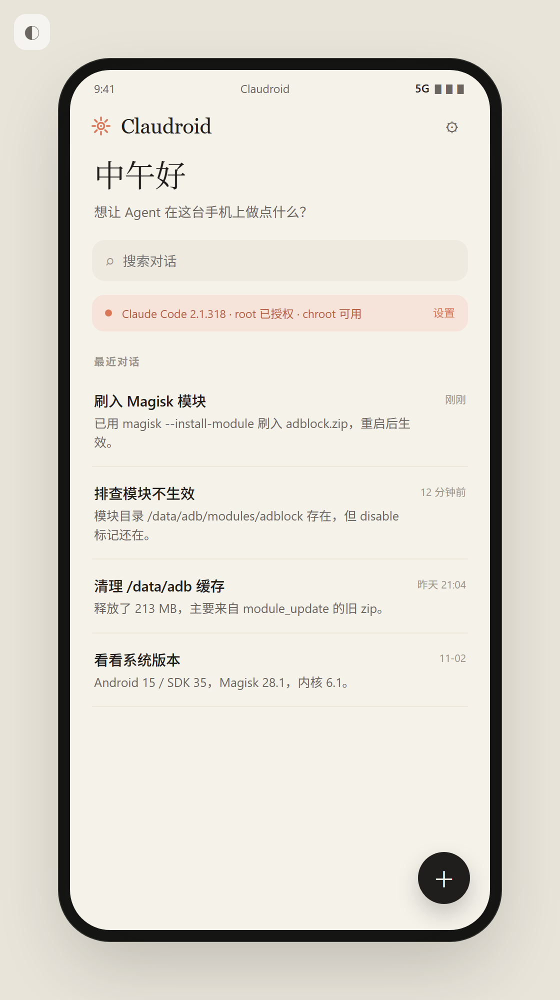
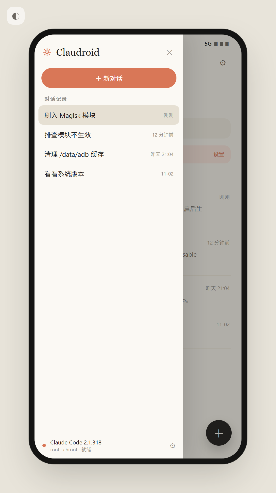
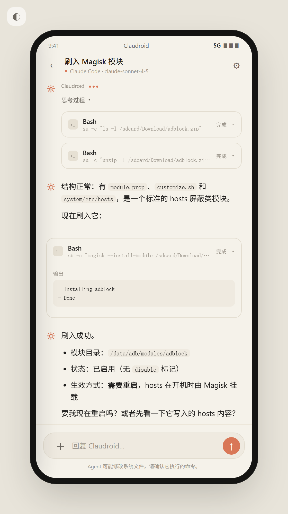
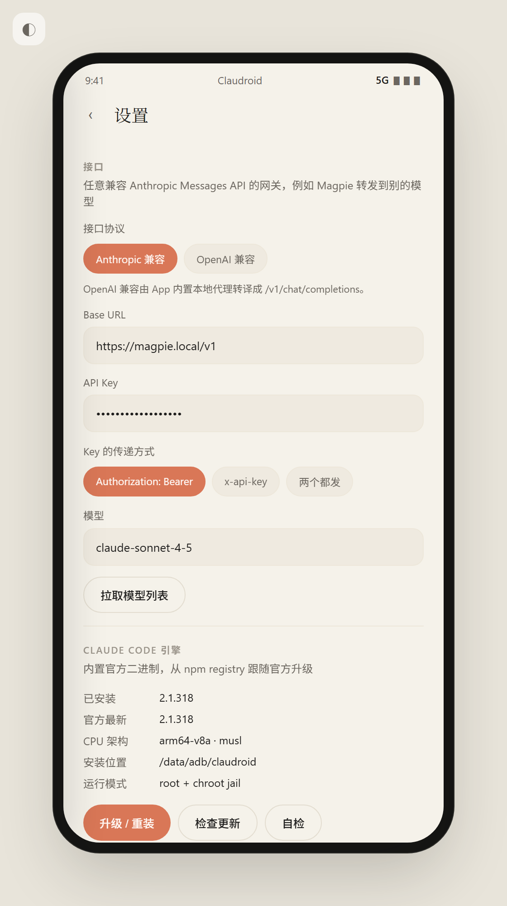
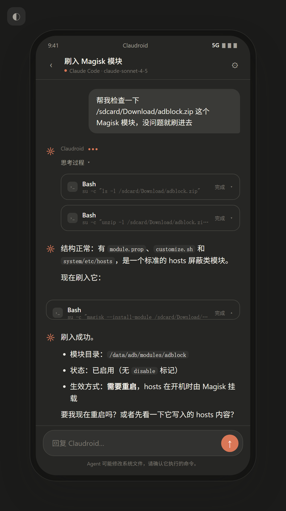
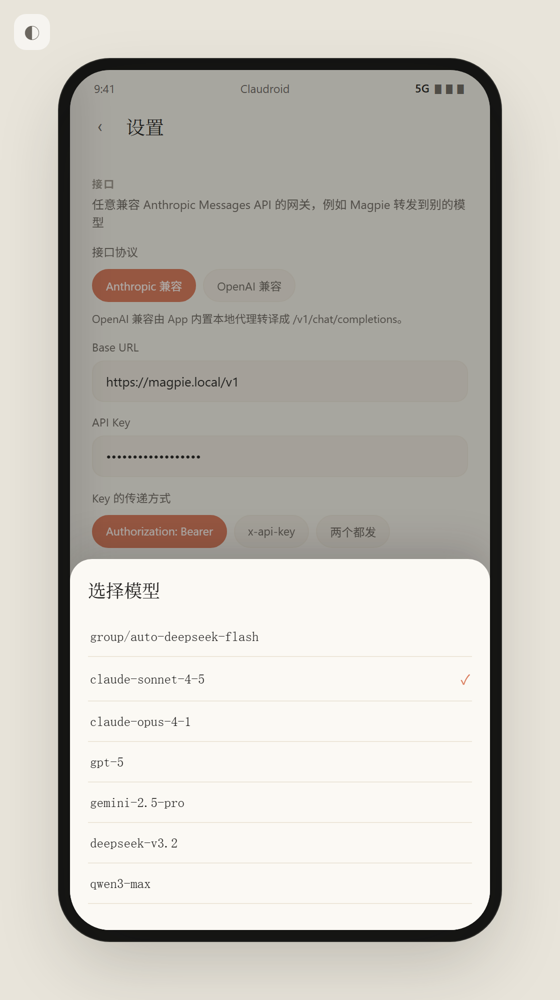

# Claudroid · 手机上的 Claude Code Agent

一个 Android 端的 AI Agent 客户端：界面参考 Claude 客户端（暖纸色 + 陶土橙 + 卡片式会话流），
后端把**官方 Claude Code CLI 直接跑在手机本地**。**没有 root 也能用**（内置 Termux PRoot），
有 root 时自动切换到 chroot，Agent 就能真正操作这台设备（刷 Magisk 模块、改系统文件、执行 su 命令）。

```
┌──────────────── Android App（Kotlin + Compose）────────────────┐
│  会话列表 / 对话流 / 设置                                       │
│    · 流式输出、思考过程折叠、工具调用卡片、费用/耗时             │
│    · Anthropic / OpenAI 兼容端点 + 服务商预设 + 模型列表         │
├─────────────────── 引擎层（纯 Kotlin，零第三方 SDK）─────────────┤
│  Toolchain：下载 / sha512 校验 / 解包 / 组装 jail / 版本切换      │
│  ClaudeEngine：spawn CLI → 解析 stream-json → UI 事件           │
│  ProotRunner：免 root 启动（Termux PRoot，打包进 jniLibs）       │
│  RootExec：su -c + chroot（有 root 时能力最全）                  │
└───────────────────────┬─────────────────────┬───────────────────┘
                        │ 无 root              │ 有 root
┌───────────────────────▼──────────┐  ┌───────▼───────────────────┐
│ filesDir/engine/jail（PRoot）     │  │ /data/adb/claudroid       │
│  /lib/ld-musl-aarch64.so.1        │  │  busybox chroot           │
│  /bin/busybox /bin/bash           │  │  /system /data /sdcard    │
│  /opt/claude/<ver>/claude         │  │  bind mount，真实设备      │
│  /work ← 工作区 bind              │  │  /work ← 工作区 bind      │
└───────────────────────────────────┘  └───────────────────────────┘
```

## 界面

视觉语言对齐 Claude 官网 / Claude 客户端：暖米白纸面（#F5F2EA）、唯一陶土橙强调色（#D97757）、
衬线标题、发丝级分割线、几乎不用投影 —— 让对话本身是屏幕上最重的东西。

| 会话列表 | 侧边栏抽屉 | 对话（浅色） |
| --- | --- | --- |
|  |  |  |

| 设置 | 深色对话 |
| --- | --- |
|  |  |

模型列表可直接从接口拉取：



上面的截图来自 `prototype/index.html` 的真实渲染（headless Chrome 截图）。
原型支持深链：`#chat` / `#settings`、`?theme=dark`、`?still=1`（关掉动画，便于截图）。

## 三个关键设计决定

### 1. 不打包 Node —— 2.x 已经是原生二进制

实测当前 npm 包（`@anthropic-ai/claude-code` 2.1.x）的元数据：

```
bin  = {"claude":"bin/claude.exe"},  deps = {},  unpackedSize = 190570
optionalDependencies = { @anthropic-ai/claude-code-linux-arm64-musl: 2.1.x, … }
```

真正的程序在平台包里，解出来是**单个约 306 MB 的 AArch64 ELF**：

```
ELF64 / type EXEC / machine AARCH64
PT_INTERP: /lib/ld-musl-aarch64.so.1      ← 动态链接 musl，不是静态
```

所以「内置 CLI」= 官方平台包 + Alpine musl 加载器，**根本不需要 Node**。
这也正是「跟随官方升级」的实现方式：上游发版，App 下次检查就能装。

### 2. targetSdk 28 + PRoot，让无 root 也能执行

Android 10 起，`targetSdk ≥ 29` 的应用**不允许 exec() 自己数据目录里的文件**（W^X / SELinux，
`app_data_file` 被撤销 `execute`）。而 CLI 正是运行时下载、放进应用目录的可执行文件。

两条路，和 Termux / dsh-Go 的做法一致：

- **targetSdk 固定为 28**。这不是忘了升，而是 PRoot 和 jail 内二进制能执行的前提。
  本项目不面向 Play 商店。
- **PRoot 本体放在 `jniLibs`**。Android 会把 `lib*.so` 解到 `nativeLibraryDir`
  （可执行、应用自有），Termux 的 `proot`、`loader`、`libtalloc.so.2`、
  `libandroid-shmem.so` 就在这里被改名/改写后打包。构建时由
  `tools/fetch-proot.py` 自动完成，不把第三方 GPL 二进制提交进仓库。

没有 root 时，jail 在 `filesDir/engine/jail`，PRoot 把工作区、`/dev`、`/proc`、`/system`
等 bind 进去；有 root 时 jail 改放 `/data/adb/claudroid`，换成 `chroot`，并额外挂载
`/data` 与 `/sdcard`。

### 3. root 是可选项，不是前提

- **自动 / PRoot**：不需要 root，能读写工作区、跑命令、改工作区里的文件。
  受 Android 沙箱限制，不能直接改 `/system` 或其它应用的私有数据。
- **Root**：`su` + `chroot`，jail 里直接看到真实 `/system`、`/data`、`/sdcard`。
  刷模块就是标准 `magisk --install-module`，少一层协议、少一个桥接进程。

每个 turn 一个进程，`--resume <session-id>` 续上下文；崩溃或切后台都不会污染下一次对话。

## 快速开始

### 构建

需要 JDK 17、Android SDK（platform 35 + build-tools 35）、Python 3。

```bash
python3 tools/fetch-proot.py --all     # 下载并打包 PRoot 运行时
./gradlew testDebugUnitTest
./gradlew assembleDebug
adb install -r app/build/outputs/apk/debug/app-debug.apk
```

Windows 可用仓库脚本一键装工具链，再执行 `tools/build-apk.sh`：

```bash
bash tools/setup-toolchain.sh     # JDK17 / cmdline-tools / SDK / Gradle → C:\dev-toolchain
bash tools/build-apk.sh
```

也可以用 Android Studio 直接打开项目。

### CI / 发版

- `.github/workflows/ci.yml`：PR 跑单测 + `assembleDebug`，上传 debug APK。
- `.github/workflows/release.yml`：push `main` 自动生成 `v0.1.<run_number>`，
  跑测试、`assembleRelease`、生成 release notes 并创建 GitHub Release。
- 版本号/`versionCode` 由 CI 注入，**不要手改**。
- 可选签名 Secrets：`ANDROID_KEYSTORE_BASE64`、`ANDROID_KEYSTORE_PASSWORD`、
  `ANDROID_KEY_ALIAS`、`ANDROID_KEY_PASSWORD`。没有配置时用 debug key 签名，仍可侧载。

### 首次配置（App 内「设置」）

| 项 | 说明 |
| --- | --- |
| 服务商预设 | Anthropic 官方 / DeepSeek（Anthropic 兼容或 OpenAI 兼容）/ OpenRouter / 本地 Ollama |
| Base URL | Anthropic 兼容端点填到根路径（CLI 会追加 `/v1/messages`）；OpenAI 兼容填到 `/v1` |
| API Key | 本地/内网端点（127.0.0.1、192.168.x、10.x、172.16-31.x、`.local`）可以留空 |
| 鉴权方式 | `Authorization: Bearer` / `x-api-key` / 两个都发；官方 Anthropic 用 `x-api-key` |
| 模型 | 可从接口拉取，也可手填；会写进 `ANTHROPIC_MODEL` 与 `--model` |
| 引擎模式 | **自动**（有 root 用 chroot，否则 PRoot）/ **Proot** / **Root** |
| 权限模式 | `完全放行` / `自动改文件` / `默认（只读）` / `只读规划` |

首次启动会在后台下载内置 CLI（约 150 MB，落盘约 310 MB，建议 Wi-Fi）。
完成后点**自检**，看到 `2.1.x (Claude Code)` 和实际启动方式（PRoot / root + chroot）说明这台机器能跑。

### 用起来

直接在对话框下命令，例如：

- `看看现在装了哪些 Magisk 模块，哪些是禁用状态`（root 模式）
- `把 /sdcard/Download/adblock.zip 刷进去，刷完告诉我它往 hosts 写了什么`（root 模式）
- `这模块开机不生效，查一下 /data/adb/modules 下的标记文件和 logcat`
- `在工作区写一个 Python 脚本，统计 attachments 里 CSV 的行数`
- `看看当前目录结构，解释这个项目怎么构建`

每个工具调用在对话里就是一张可展开的卡片（命令 / 入参 / 输出 / 成败）。
输入框左侧 `+` 可以把任意文件复制进工作区，并自动插入 `@attachments/文件名`。

## 跟随官方升级

- 启动时（可关）查 `registry.npmjs.org/@anthropic-ai/claude-code/latest`；
- 设置页显示「已安装 / 官方最新 / 占用空间」；
- 「升级 / 重装」= 下载 → 校验 sha512 → 解包到新目录 → 重新组装 jail → 删除旧版本。

没有任何硬编码版本号，上游发版即生效。

## 安全边界（重要）

- 默认 `AUTO`：没有 root 授权时走 PRoot，能力被 Android 沙箱限制，不会误改系统。
- 切到 **Root + 完全放行** 等于**把无确认的 root shell 交给模型**：可读 `/data`、改 `/system`、
  `magisk --install-module`。请只在明确需要时使用。
- 想保留控制感：`默认（只读）`（`default`）或 `只读规划`（`plan`）。headless 模式下没有交互式批准，
  未被允许的工具会被 CLI 直接拒绝并回给模型（`--permission-mode default` 只读，不会弹窗）。
- 无遥测：`DISABLE_TELEMETRY`、`CLAUDE_CODE_DISABLE_NONESSENTIAL_TRAFFIC`、
  `DISABLE_AUTOUPDATER` 全部打开（升级由 App 管）。
- root 模式下 App 会设置 `IS_SANDBOX=1` —— 这是上游给「容器/沙箱内 root」场景的开关，
  否则 CLI 会拒绝 `bypassPermissions`。
- API Key 只保存在本机 DataStore；OpenAI 兼容模式下真实 Key 只交给本地代理，
  CLI 拿到的是占位 token。仓库、日志、Release 里不出现任何 Key。

## 目录

```
claudroid/
├── app/src/main/java/app/claudroid/
│   ├── core/Paths.kt           安装记录（版本 / jail 位置 / 模式）、工作区、会话目录
│   ├── data/                   设置(DataStore) + 服务商预设 + 会话(JSON 文件)
│   ├── engine/
│   │   ├── Registry.kt         npm registry 查询 + Alpine 包解析
│   │   ├── HttpUtil.kt         下载 + sha512 + 断点续传
│   │   ├── TarGz.kt            极简 tar.gz 抽取（有单测）
│   │   ├── Toolchain.kt        下载/校验/组装 jail（root 脚本 or 应用侧）
│   │   ├── ProotRunner.kt      PRoot 启动参数 + 宿主 bind（有单测）
│   │   ├── ShellSupport.kt     直启模式下的 /bin/sh 包装
│   │   ├── ClaudeEngine.kt     进程启动 + 四种执行路径
│   │   ├── StreamParser.kt     stream-json 解码（有单测）
│   │   ├── openai/             OpenAI 兼容桥：协议翻译 + 本地代理 + 模型列表
│   │   ├── RootExec.kt         su / busybox / chroot 探测与执行
│   │   └── EngineManager.kt    生命周期状态机 + 自检 + 存储统计
│   ├── ui/                     Compose：home / chat / settings / markdown / theme
│   └── ui/theme/               暖纸色 + 陶土橙配色
├── app/src/test/java/…         单测（协议翻译 / 解析 / tar / proot 参数 / 设置）
├── prototype/index.html        高保真可点击 Web 原型
├── docs/screenshots/           原型真实渲染截图（浅色 / 深色）
├── tools/
│   ├── fetch-proot.py          构建期下载 Termux PRoot 并改写成 jniLibs
│   ├── setup-toolchain.sh      一键装 JDK/SDK/Gradle
│   ├── build-apk.sh            编译
│   ├── mock-anthropic.mjs      本地假 Anthropic 端点，抓 CLI 真实事件流
│   └── fetch-cli.sh            手动预下载 CLI + musl 加载器
└── .github/workflows/          PR 检查 + push main 自动发版
```

## 接口协议：Anthropic 与 OpenAI 都支持

| 协议 | 适用 | 实现方式 |
| --- | --- | --- |
| **Anthropic 兼容** | Anthropic 官方、DeepSeek 的 `/anthropic` 端点、Magpie 等网关 | base URL 直接交给 CLI |
| **OpenAI 兼容** | OpenAI、DeepSeek、OpenRouter、one-api / new-api、Ollama | App 内起**本地代理**做双向翻译（文本 / 图片 / tool_calls / 流式 / reasoning） |

OpenAI 模式的链路：

```
Claude Code CLI --(Anthropic /v1/messages)--> 127.0.0.1:<随机端口>  内置代理
                                                     │ 翻译 messages / tools / tool_choice / images
                                                     ▼
                                        <你的 base URL>/v1/chat/completions
                                                     │ 流式 chunk 翻译回 Anthropic SSE
                                                     ▼
                                              CLI 收到标准事件
```

真实 API Key 只交给代理，CLI 拿到的是占位 token。代理随设置变化自动重建。
请求的 `stream` 标志会原样转发；DeepSeek / OpenRouter 的 `reasoning_content` 会显示为思考过程。

## 这一轮补齐的功能

- **免 root 引擎**：Termux PRoot 打包进 APK，targetSdk 28 允许在应用目录执行；
  没有 root 也能完整跑 Claude Code。
- **引擎模式**：自动 / Proot / Root 三选一；设置页显示实际运行方式、PRoot 是否可用、
  root/chroot 状态、引擎占用空间，并支持卸载（可保留会话）。
- **GNU bash**：jail 里补上 Alpine bash + readline + ncursesw，Bash 工具不再退化。
- **服务商预设**：Anthropic、DeepSeek（两种协议）、OpenRouter、Ollama 一键填充；
  本地/内网端点允许空 Key。
- **OpenAI 桥修复**：非流式请求不再被强制 `stream=true`；补上图片转 `image_url`、
  `reasoning_content` -> thinking、`finish_reason=length` -> `max_tokens`、
  上游 401/429/400 状态映射、无 Key 时不发空 Authorization。
- **会话健壮性**：崩溃后修复 `streaming` / `running` 状态；`--resume` 指向已删除会话时
  自动新开会话重试；删除会话会停止正在运行的任务；并发发送会被拒绝。
- **UI**：流式文本自动滚动（用户上翻后不打扰）；助手消息显示费用/耗时；工具行改为
  「自动改文件」的准确描述；空状态与错误提示更新。
- **CI/CD**：PR 单测 + debug APK；push main 自动 `v0.1.<run_number>` 发版。

## 常见问题

| 现象 | 原因与处理 |
| --- | --- |
| 自检报 `proot 组件缺失` | APK 不是用 `tools/fetch-proot.py` 构建的，或用了 `-PskipProot`。用正式构建产物。 |
| PRoot 启动报 `Permission denied` / `exec format error` | 确认 `targetSdk` 仍是 28；确认安装的是 arm64-v8a 或 x86_64 包。 |
| 提示「引擎安装在 root 目录，但当前没有 root」 | 切到「自动」重新授权，或把模式改为 Proot 后点「升级 / 重装」。 |
| 发消息后没反应，日志里 `自检结果：Bus error` | 安装文件被截断（下载中断）或存储不足。**设置 → Claude Code 引擎 → 升级 / 重装**。下载支持断点续传与 3 次重试。 |
| 自检输出 `binary: 12345678 字节` | 正常应约 306 MB；明显偏小就是没下完，点「升级 / 重装」。 |
| `chroot: can't change root` | 设备缺 `chroot(1)`，App 会自动降级为「加载器直启」。 |
| 请求超时 | jail 里 DNS 不通：PRoot 会自动写入当前网络的 DNS；root 模式检查 `/data/adb/claudroid/etc/resolv.conf`，或把 Base URL 换成 IP。 |
| `--dangerously-skip-permissions cannot be used with root/sudo privileges` | 官方在 uid 0 下禁止「完全放行」。App 会自动注入 `IS_SANDBOX=1`；若仍出现，把权限模式改成「默认（只读）」或「只读规划」。 |
| 一直停在升级进度不动 | 到 registry.npmjs.org 的网络不稳：会自动重试 3 次并续传；仍失败可检查网络或代理。 |
| OpenAI 兼容端点 400/404 | Base URL 要填到 `/v1`（代理会补 `/chat/completions`）；确认模型名和接口支持 tool_calls。 |

## 已知限制

- 仅 arm64-v8a / x86_64（上游只发布这两个）；32 位设备不支持。
- PRoot 有 ptrace 开销，重度 I/O（解压大包）比原生慢；root + chroot 更快。
- PRoot 模式受 Android 沙箱限制，不能改 `/system` 或其他应用数据；需要这些能力请用 root 模式。
- 没有「逐条批准工具调用」的图形界面；headless 下由 CLI 的权限模式决定。
- 一个 turn 一个进程（+ `--resume`），换来稳定；代价是每轮约 100 ms 启动开销。
- 截图为原型渲染，真机 UI 以 Compose 实现为准（布局一致）。
